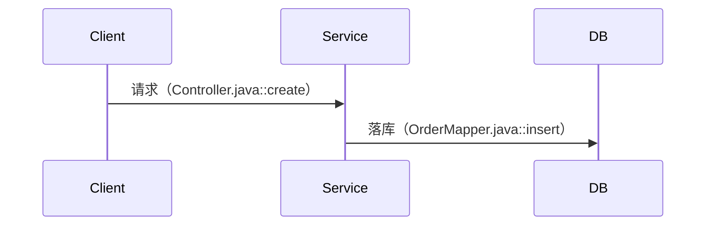
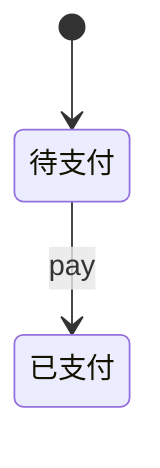
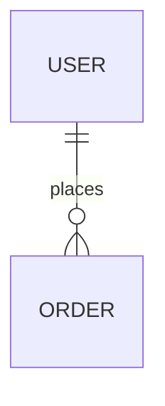

# Legacy Project Wiki — 产物模板

> 所有产物写入 `.harness/wiki/`。模板锁定，跨文件结构保持一致，便于下游 agent 消费。

---

## 00-recon.md

```markdown
# 全局侦察 — {项目名}

## 1. 技术栈
| 类别 | 结论 | 证据 |
|------|------|------|
| 语言 / 版本 | ... | pom.xml:12 |
| 框架 | ... | ... |
| ORM / DB / 缓存 / MQ / 调度 | ... | ... |

## 2. 目录结构（深度 2）
```
src/
├── xxx/     # 推测职责：... [待确认]
```

## 3. 入口点清单
| 类型 | 入口文件:行号 | 前缀 / 名称 |
|------|--------------|------------|
| HTTP 路由注册 | ... | /api/v1/... |
| 定时任务 | ... | ... |
| MQ 消费者 | ... | ... |
| CLI / main | ... | ... |

## 4. 配置与环境变量
| 配置项 | 路径 / 键 | 说明 |
|--------|-----------|------|

## 5. 规模与热点
- 代码行数 Top 20：...
- 第三方服务清单：...
```

---

## 01-capability-map.md

```markdown
# 业务能力地图 — {项目名}

| 能力域 | 说明 | 主要 endpoint | 入口文件:行号 |
|--------|------|--------------|--------------|
| 用户认证 | ... | POST /api/v1/user/login | AuthController.java:34 |

## 未分类
| endpoint | 无法归类原因 |
|----------|-------------|

## 总数校验
- 扫描到 endpoint：N 个
- 归类到能力域：M 个
- 未分类：K 个（N = M + K）

## 待深入分析 Top 10
1. ... （endpoint 数 / 业务重要性）
```

---

## domains/{domain}.md

```markdown
# 业务域：{domain}

## 1. 概述
（3 句话内）

## 2. 端到端流程


## 3. 数据模型
| 表名 | 关键字段 | 索引 | 建表 SQL 位置 |
|------|---------|------|--------------|

## 4. 业务规则
| # | 规则 | 证据 |
|---|------|------|
| 1 | 订单金额 = 单价 × 数量 - 优惠 | OrderService.java:120 |

## 5. 状态机


## 6. 外部依赖
- 其他服务 / 第三方 API / MQ topic / 缓存 key

## 7. 已知坑 / 特殊逻辑
- TODO/FIXME、魔法数字、硬编码、绕过逻辑

## 8. 待确认问题
| 疑问 | 已查证范围 | 需要谁确认 |
|------|-----------|-----------|
```

---

## 02-architecture.md

```markdown
# 架构与横切关注点 — {项目名}

## 1. 认证与授权
## 2. 错误处理
## 3. 事务边界
## 4. 缓存策略
## 5. 日志与监控
## 6. 配置与开关
## 7. 部署拓扑

> 每条结论附代码位置；推断内容标 [推断]。
```

---

## data/er.md

```markdown
# 全局实体关系



| 表 | 所属域 | 关键字段 | 建表 SQL 位置 |
|----|--------|---------|--------------|
```

---

## data/state-machines.md

```markdown
# 状态机汇总

## {实体名}
| 状态 | 触发动作 | 下一状态 | 证据 |
|------|---------|---------|------|


```

---

## flows/{flow}.md

```markdown
# 跨域流程：{flow}

涉及业务域：{域1} → {域2} → {域3}

```mermaid
sequenceDiagram
  ...
```

| 步骤 | 业务域 | 入口（文件:函数） |
|------|--------|------------------|
```

---

## README.md

```markdown
# {项目名} 业务 Wiki

## 阅读顺序（新人上手路径）
1. [00-recon.md](00-recon.md) — 技术栈与入口
2. [01-capability-map.md](01-capability-map.md) — 业务能力地图
3. [domains/xxx.md](domains/xxx.md) — ...

## 文件摘要
| 文件 | 一句话摘要 |
|------|-----------|

## 业务域 → 代码路径 反查表
| 业务域 | 代码路径 |
|--------|---------|

## 待确认问题
见 [_pending.md](_pending.md)
```

---

## _pending.md

```markdown
# 待确认问题汇总

| # | 出处 | 疑问 | 已查证范围 | 需要谁确认 |
|---|------|------|-----------|-----------|
```

---

## _audit.md

```markdown
# 审计报告

抽检条数：20

| 文档位置 | 结论 | 证据核对 | 判定 |
|----------|------|---------|------|
| domains/order.md:45 | ... | OrderJob.java:88 ✅ | 通过 |
| domains/order.md:52 | ... | 未找到校验 | ❌ 错误 |

## 修正建议
- domains/order.md:52 → ...
```